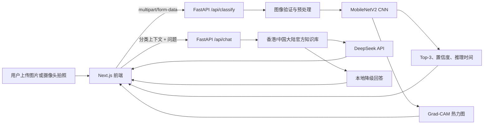

# EcoVision AI 完整构建、训练与交付方案书

> 项目名称：EcoVision AI
>
> 项目类型：生成式 AI + 计算机视觉期末项目
>
> 构建日期：2026-10-21（Asia/Hong_Kong）
>
> GitHub：<https://github.com/Fichend/ecovision-ai>

## 1. 项目目标

EcoVision AI 是一个面向香港和中国大陆场景的英文回收辅助系统。用户可以上传垃圾图片或调用摄像头，系统先使用本地 CNN 判断物品的视觉类别，再通过 Grad-CAM 展示模型关注区域，最后结合官方回收知识库和 DeepSeek API 给出带来源的处理建议。

项目坚持三个原则：

1. CNN 分类结果与大语言模型回答分离，DeepSeek 不能偷偷修改 CNN 结果。
2. 显示置信度、Top-3 分类和模型局限，不把预测包装成事实。
3. 回收建议优先依据香港、中国大陆官方资料；DeepSeek 不可用时自动退回本地知识库。

## 2. 最终交付成果

- 六分类 MobileNetV2 图像分类模型
- 可复现的数据验证、去重、分组切分、训练和评估代码
- Apple Silicon MPS 加速训练与推理
- FastAPI 推理和知识问答后端
- Grad-CAM 可解释性热力图
- DeepSeek API 接入和本地知识库降级机制
- Next.js 响应式英文前端
- 图片上传、拖放、MPO 图片兼容和实时摄像头拍照
- 香港/中国大陆位置切换和官方来源链接
- 自动化测试、类型检查和生产构建
- 已训练模型、评估指标、混淆矩阵和训练历史

主模型在近重复样本分组后的独立测试集上达到：

| 指标 | 结果 |
| --- | ---: |
| Test accuracy | 92.33% |
| Test macro-F1 | 90.11% |
| Macro precision | 89.47% |
| Macro recall | 91.23% |
| Best validation macro-F1 | 88.70% |

## 3. 系统架构



技术分层如下：

| 层级 | 技术 | 责任 |
| --- | --- | --- |
| 前端 | Next.js 16、React 19、TypeScript、Tailwind CSS | 上传、拍照、结果展示、问答和评估页面 |
| API | FastAPI、Pydantic、Uvicorn | 文件校验、推理接口、问答接口和健康检查 |
| 图像模型 | PyTorch、Torchvision、MobileNetV2 | 六分类推理和迁移学习 |
| 可解释性 | 手工实现 Grad-CAM、OpenCV | 生成模型关注区域热力图 |
| 生成式 AI | DeepSeek OpenAI-compatible API | 基于检索证据生成英文建议 |
| 知识层 | JSON 官方资料知识库 | 香港及中国大陆回收规则和来源 |
| 浏览器状态 | IndexedDB + 内存回退 | 保存大图片和最近一次识别结果 |

## 4. 七阶段开发过程

### 阶段 1：需求和范围确定

- 使用英文界面和英文回答。
- 回收知识优先覆盖香港和中国大陆。
- 图像识别必须由 CNN 完成。
- 大模型使用 DeepSeek API，但不能覆盖 CNN 输出。
- 需要展示模型解释、置信度和限制。
- 项目需要能够在 MacBook 的 Anaconda 环境运行。

### 阶段 2：环境验证与独立环境建立

最初检查过已有环境，但为了避免依赖污染，最终建立 `ecovision` 环境。该环境已经通过 PyTorch MPS 训练烟雾测试。

### 阶段 3：数据获取、清洗与切分

使用官方 TrashNet 数据集，对图片进行完整性检查、内容哈希去重、标签冲突清理、感知哈希分组和可复现切分。

### 阶段 4：CNN 训练与模型选择

使用 ImageNet 预训练 MobileNetV2。先冻结特征提取器训练分类头，再解冻整个网络进行微调。最优模型由验证集 macro-F1 选择。

### 阶段 5：模型评估与可解释性

只在模型选择完成后使用测试集一次。输出 accuracy、macro-F1、分类报告、混淆矩阵、训练曲线和 Grad-CAM。

### 阶段 6：后端、知识库与 DeepSeek

建立 FastAPI 接口、模型懒加载、图片安全验证、官方知识检索、DeepSeek grounded prompt 和失败降级机制。

### 阶段 7：前端、集成与验收

实现响应式前端、摄像头、MPO 支持、大图 IndexedDB 存储、助手页面和评估页面；完成自动化测试、生产构建及浏览器端到端验证。

## 5. Anaconda 虚拟环境

### 5.1 已验证环境版本

| 软件 | 版本 |
| --- | --- |
| Python | 3.11.17 |
| PyTorch | 2.14.1 |
| Torchvision | 0.29.1 |
| FastAPI | 0.156.4 |
| OpenCV | 5.0.0 |
| scikit-learn | 1.9.1 |
| pandas | 3.0.6 |
| seaborn | 0.13.2 |
| OpenAI-compatible SDK | 3.35.1 |
| Node.js | 22.23.2 |
| pnpm | 11.25.0 |

MPS 检查结果：`torch.backends.mps.is_built() == True`，`torch.backends.mps.is_available() == True`。

### 5.2 从零创建环境

```bash
conda create -n ecovision python=3.11 -y
conda activate ecovision

cd ecovision-ai
python -m pip install -e ".[test]"

conda install -c conda-forge nodejs=22 -y
corepack enable
corepack prepare pnpm@11.25.0 --activate

cd frontend
pnpm install --frozen-lockfile
cd ..
```

### 5.3 注册 Jupyter 内核（可选）

```bash
conda activate ecovision
python -m pip install ipykernel
python -m ipykernel install \
  --user \
  --name ecovision \
  --display-name "Python (ecovision)"
```

### 5.4 环境检查

```bash
python -m pip check

python - <<'PY'
import torch
import torchvision

print("PyTorch:", torch.__version__)
print("Torchvision:", torchvision.__version__)
print("MPS built:", torch.backends.mps.is_built())
print("MPS available:", torch.backends.mps.is_available())
PY
```

## 6. 训练数据

### 6.1 数据来源

使用 Gary Thung 和 Mindy Yang 创建的 TrashNet：

- 官方仓库：<https://github.com/garythung/trashnet>
- Hugging Face 镜像：<https://huggingface.co/datasets/garythung/trashnet>

原始数据共有 2,527 张图片，六个类别：

| 类别 | 原始数量 |
| --- | ---: |
| cardboard | 403 |
| glass | 501 |
| metal | 410 |
| paper | 594 |
| plastic | 482 |
| trash | 137 |
| 合计 | 2,527 |

原始图片主要在干净白色背景上拍摄，因此测试分数不能直接等同于街头、家庭垃圾桶或混合垃圾场景表现。

### 6.2 数据目录

```text
data/raw/dataset-resized/
├── cardboard/
├── glass/
├── metal/
├── paper/
├── plastic/
└── trash/
```

原始数据不放入 GitHub，避免仓库过大；训练完成的模型已包含在仓库中，所以只运行应用不需要重新下载数据。

## 7. 数据清洗与防泄漏切分

执行命令：

```bash
python -m ecovision_ml.prepare_data \
  --source data/raw/dataset-resized \
  --output data/processed \
  --seed 42
```

处理步骤：

1. 遍历六个类别目录。
2. 使用 Pillow 解码和验证每张图片。
3. 记录图片宽高。
4. 计算 SHA-256 内容哈希。
5. 删除完全相同的重复内容。
6. 如果同一内容被标为不同类别，删除该内容的所有冲突副本。
7. 计算 64-bit dHash 感知哈希。
8. 将相同类别、Hamming distance 小于等于 4 的近重复图片放入同一组。
9. 按组进行 70%/15%/15% 的 train/validation/test 切分。
10. 使用 seed 42 保存可复现的 `manifest.csv`。

清洗结果：

- 发现图片：2,527
- 标签冲突图片：6，全部排除
- 最终可用图片：2,521
- 相似度分组：2,455
- Train：1,765
- Validation：378
- Test：378
- dHash 距离 0、2、4 的跨集合近重复审计：0 对

这一步非常重要。早期普通随机分层切分存在 39 对跨集合近重复图片，因此虽然其准确率为 91.03%，但不能作为主要结果。最终报告只采用分组切分模型。

## 8. CNN 图像分类器训练

### 8.1 模型选择

选择 MobileNetV2，原因包括：

- 参数量和推理成本较低，适合本地应用。
- Torchvision 提供稳定的 ImageNet 预训练权重。
- 对小型数据集使用迁移学习比从零训练更可靠。
- 可以在 Apple MPS 上训练和推理。

将原始分类层替换为六分类线性层：

```text
MobileNetV2 classifier output: 1000 classes → 6 classes
```

类别顺序：

```text
0 cardboard
1 glass
2 metal
3 paper
4 plastic
5 trash
```

### 8.2 图像预处理与增强

训练集处理：

1. `RandomResizedCrop(224, scale=(0.75, 1.0))`
2. `RandomHorizontalFlip()`
3. `RandomRotation(12)`
4. `ColorJitter(brightness=0.2, contrast=0.2, saturation=0.15)`
5. 转 Tensor
6. ImageNet mean/std 标准化

验证和测试处理：

1. Resize 到 256
2. CenterCrop 到 224×224
3. 转 Tensor
4. 使用相同 ImageNet 标准化

标准化参数：

```text
mean = [0.485, 0.456, 0.406]
std  = [0.229, 0.224, 0.225]
```

### 8.3 类别不平衡处理

`trash` 类样本远少于其他类别，因此使用基于训练集类别频率反比计算的 class weights，并传入加权交叉熵：

```text
CrossEntropyLoss(weight=class_weights)
```

### 8.4 两阶段迁移学习

训练参数：

| 参数 | 值 |
| --- | --- |
| Epochs | 10 |
| Batch size | 32 |
| Image size | 224 |
| Optimizer | AdamW |
| Weight decay | 1e-4 |
| Seed | 42 |
| Device | MPS |
| 分类头学习率 | 0.001 |
| 解冻后 backbone 学习率 | 0.0001 |

训练过程：

- Epoch 1–2：冻结 MobileNetV2 feature extractor，只训练新分类头。
- Epoch 3–10：解冻 feature extractor，对 backbone 使用较低学习率进行微调。
- 每个 epoch 计算训练集和验证集 loss、accuracy、macro-F1。
- 根据最高 validation macro-F1 保存 `best_model.pt`。
- 模型选择结束后，仅对 test set 评估一次。

执行命令：

```bash
python -m ecovision_ml.train \
  --manifest data/processed/manifest.csv \
  --output artifacts/mobilenet_v2_grouped_baseline \
  --epochs 10 \
  --freeze-epochs 2 \
  --batch-size 32 \
  --image-size 224 \
  --learning-rate 0.001 \
  --seed 42 \
  --device auto
```

`auto` 设备选择顺序是 MPS → CUDA → CPU。

### 8.5 训练输出

```text
artifacts/mobilenet_v2_grouped_baseline/
├── best_model.pt
├── model_metadata.json
├── history.json
├── training_history.png
├── classification_report.json
├── confusion_matrix.csv
└── confusion_matrix.png
```

仓库同时保留普通随机切分基线作为对照，但应用默认加载 group-aware 模型。

## 9. 模型评估

每个类别的测试表现：

| 类别 | Precision | Recall | F1 | 测试样本 |
| --- | ---: | ---: | ---: | ---: |
| Cardboard | 98.33% | 98.33% | 98.33% | 60 |
| Glass | 96.97% | 85.33% | 90.78% | 75 |
| Metal | 88.06% | 96.72% | 92.19% | 61 |
| Paper | 97.67% | 94.38% | 96.00% | 89 |
| Plastic | 90.41% | 91.67% | 91.03% | 72 |
| Trash | 65.38% | 80.95% | 72.34% | 21 |

主要弱点是 `trash` 类。该类只有 137 张原始图片，测试集只有 21 张，因此统计不确定性明显高于其他类别。

## 10. Grad-CAM 可解释性

推理时在 MobileNetV2 最后一个卷积特征层注册 forward hook 和 gradient hook：

1. 前向传播得到预测类别。
2. 对预测类别 logit 反向传播。
3. 对梯度在空间维度取平均，得到每个通道的权重。
4. 加权汇总激活图并应用 ReLU。
5. 将热力图归一化、缩放到原图尺寸。
6. 使用 OpenCV 颜色映射并与原图叠加。
7. 以 PNG Data URL 返回前端。

Grad-CAM 只能说明模型重点关注了哪里，不能证明该区域导致了正确预测，因此页面保留了明确免责声明。

## 11. FastAPI 后端

后端入口：`src/ecovision_api/main.py`。

| 接口 | 方法 | 功能 |
| --- | --- | --- |
| `/api/health` | GET | 模型、设备、知识库和 DeepSeek 状态 |
| `/api/classify` | POST | 图片分类、Top-3、置信度和 Grad-CAM |
| `/api/chat` | POST | 基于分类上下文和知识库的回收问答 |

图片安全控制：

- MIME 类型限制为 JPEG、PNG、WebP。
- 默认最大上传大小 10 MB。
- 检查空文件、无效图片和异常尺寸。
- 最小尺寸为 16×16。
- 最大像素总量为 40,000,000。
- Pillow 解码为 MPO 时读取首帧并转换为 RGB，兼容手机多帧 JPEG。
- 模型推理加锁，避免 MPS 并发访问问题。

## 12. DeepSeek 与回收知识库

### 12.1 配置

```bash
cp .env.example .env
```

在 `.env` 中填写：

```env
DEEPSEEK_API_KEY=your_key_here
DEEPSEEK_BASE_URL=https://api.deepseek.com
DEEPSEEK_MODEL=deepseek-flash
```

真实 `.env` 不进入 Git；下载者使用自己的 API key。即使不填写 key，应用仍可运行，并自动使用本地知识库回答。

### 12.2 Grounded prompt

发送给 DeepSeek 的上下文包括：

- CNN 预测类别
- Top-3 概率
- 置信度和不确定性说明
- 用户选择的位置和城市
- 检索出的知识库陈述
- 官方来源名称和网址
- 最近最多八条对话历史

系统提示要求 DeepSeek：

- 只使用提供的知识证据讨论当地回收规则。
- 不得替换 CNN 分类。
- 不得声称视觉分类证明了材料成分。
- 信息不足时必须要求用户核实。
- 不得编造回收规则。

### 12.3 降级机制

以下情况自动切换到本地知识库：

- 未配置 API key
- DeepSeek 余额不足
- 网络错误
- 超时或服务不可用
- 其他 API 异常

因此生成式 AI 故障不会破坏 CNN 分类主流程。

### 12.4 知识来源

香港来源：

- [GREEN@COMMUNITY recycling FAQ](https://www-dr.wastereduction.gov.hk/en-hk/recycling-faq/greencommunity-faq)
- [GREEN@COMMUNITY network](https://www-dr.wastereduction.gov.hk/en-hk/waste-reduction-programme/green-at-community)
- [Hong Kong EPD waste information](https://www.epd.gov.hk/epd/english/environmentinhk/waste/waste_maincontent.html)

中国大陆来源覆盖国家层面及北京、上海、南京等官方英文资料。具体来源保存在 `knowledge/recycling_guidance.json`，方便审计和更新。

## 13. 前端设计与实现

### 13.1 实际使用的前端技术

- Next.js 16 App Router
- React 19
- TypeScript
- Tailwind CSS 3
- Lucide React 图标
- Fetch API
- IndexedDB
- MediaDevices / getUserMedia
- Canvas API
- Vitest + Testing Library

### 13.2 关于 Figma 的准确说明

本项目讨论过 Figma 风格的设计规划，但最终版本**没有创建或依赖外部 Figma 文件**。前端采用 code-first 方法直接在 Next.js 和 Tailwind CSS 中实现设计系统，并通过浏览器截图、移动端/桌面端断点和实际交互进行迭代。

因此在答辩时应准确表述为：

> UI 先确定信息架构、页面流程、颜色、排版和组件规范，再直接使用 Next.js、Tailwind CSS 实现；未把 Figma 作为代码生成来源，也不存在需要随项目提交的 `.fig` 文件。

不要声称使用了不存在的 Figma 设计稿。

### 13.3 视觉规范

- 主色：深森林绿，表达环保和可靠性。
- 背景：暖白/米白色，避免传统科技产品的高饱和蓝色风格。
- 布局：大标题、卡片、圆角、明确 CTA。
- 字体层级：eyebrow、页面标题、卡片标题、正文和辅助说明。
- 响应式：手机端单列布局，桌面端多列信息布局。
- 无障碍：语义化按钮、label、alt text、`aria-live`、dialog 属性和键盘可访问控件。

### 13.4 页面结构

| 路由 | 页面 |
| --- | --- |
| `/` | 项目首页和能力介绍 |
| `/recognize` | 拖放、上传和摄像头拍照 |
| `/results` | 原图、Grad-CAM、Top-3 和置信度 |
| `/assistant` | 位置选择、DeepSeek/知识库问答和来源 |
| `/evaluation` | 数据控制、指标、混淆矩阵和限制 |

### 13.5 摄像头实现

- 使用 `navigator.mediaDevices.getUserMedia()` 请求视频流。
- 优先选择 `facingMode: environment`。
- 弹窗显示实时 `<video>` 预览。
- 使用 Canvas 截取当前帧。
- 将最长边缩放到 1600px 并输出 JPEG。
- 关闭弹窗或组件卸载时停止所有 MediaStream tracks。
- 针对权限拒绝、无设备和摄像头占用提供不同错误信息。

远程部署时摄像头需要 HTTPS；`localhost` 在现代浏览器中通常被视为安全上下文。

### 13.6 大图存储修复

早期版本把原图和 Grad-CAM Base64 写入 `sessionStorage`，超过约 5 MB 时触发 quota error。最终实现改为：

1. IndexedDB 保存最新分析结果。
2. 内存副本支持当前标签页即时导航。
3. IndexedDB 不可用时仍使用内存回退。
4. 不再向 `sessionStorage` 写入大型图片。

已使用约 8.63 MB 图片验证，识别成功且页面刷新后结果仍可恢复。

## 14. 本地运行

### 14.1 克隆仓库

```bash
git clone https://github.com/Fichend/ecovision-ai.git
cd ecovision-ai
```

仓库已包含训练好的 `best_model.pt`，因此仅运行应用不需要重新训练。

### 14.2 启动后端

```bash
conda activate ecovision
cp .env.example .env
# 可选：把自己的 DeepSeek key 写入 .env
python -m uvicorn ecovision_api.main:app --host 127.0.0.1 --port 8000
```

### 14.3 启动前端

在第二个终端中执行：

```bash
conda activate ecovision
cd ecovision-ai/frontend
pnpm install --frozen-lockfile
pnpm dev --hostname 127.0.0.1
```

访问：

- 前端：<http://127.0.0.1:3000>
- API 健康检查：<http://127.0.0.1:8000/api/health>

## 15. 测试和质量控制

后端：

```bash
conda activate ecovision
python -m pytest -q
python -m pip check
```

已通过 10 项测试，覆盖：

- API contract
- 文件类型验证
- MPO 解码
- 知识库检索
- 数据清洗和分组切分
- 模型结构
- DeepSeek 未配置时的降级回答

前端：

```bash
cd frontend
pnpm typecheck
pnpm test -- --run
pnpm build
```

已通过：

- TypeScript 类型检查
- 3 个测试文件、5 项测试
- Next.js production build
- 首页、识别、结果、助手和评估五个静态路由生成
- 移动端和桌面端浏览器验收

## 16. 外部真实照片评估

TrashNet 测试结果不能代替真实场景验证。将独立照片放到：

```text
data/external/<class-name>/image.jpg
```

运行：

```bash
python -m ecovision_ml.evaluate_external \
  --source data/external \
  --output artifacts/external_evaluation
```

如果照片按类别文件夹组织，程序会计算 accuracy 和 macro-F1；否则只导出每张图片的预测结果。建议至少准备 20–50 张不同背景、光线、角度、遮挡和混合材质的独立照片。

## 17. GitHub 发布过程

实际发布步骤：

1. 检查 `.gitignore`，确认 `.env`、`node_modules`、`.next`、缓存和原始数据不进入版本库。
2. 将两个模型权重、训练历史、混淆矩阵、分类报告和数据清单纳入 Git。
3. 对暂存内容执行 API key 模式扫描，结果为空。
4. 创建初始提交：`Initial EcoVision AI full-stack release`。
5. 使用已登录的 GitHub 账户创建公开仓库 `Fichend/ecovision-ai`。
6. 推送 `main` 分支。
7. 使用远端 ref 和 GitHub repository metadata 验证提交、默认分支和公开状态。

真实 API key 即使得到“可以泄漏”的授权也不应进入仓库，因为公开密钥可能造成余额损失、滥用和账户封禁。仓库通过 `.env.example` 提供配置模板，下载者使用自己的 key。

## 18. 完整代码包

交付 ZIP 由 Git 提交生成，因此内容与公开仓库一致，不包含本地秘密和无关缓存。包中包括：

- Python 和 TypeScript 源码
- 前后端测试
- 两个训练模型
- 训练历史和评估结果
- 数据 manifest 和 summary
- 回收知识库
- 环境模板
- README 和本方案书

## 19. 已知限制

1. TrashNet 数据规模小且背景单一。
2. `trash` 类样本明显不足。
3. 模型只能根据视觉外观分类，不能识别真实化学成分。
4. 混合材料可能无法对应单一类别。
5. 各城市回收政策会变化，需要定期更新知识库。
6. DeepSeek 会产生 API 成本，并受余额、限流和网络影响。
7. 云端部署无法使用本机 Apple MPS，需要 CPU 或云 GPU。
8. 真实世界准确率必须通过独立照片评估后才能声明。

## 20. 后续改进方向

- 收集香港和中国大陆真实回收场景图片。
- 增加 hard-negative 和混合材料样本。
- 对低置信度样本增加“无法判断”策略。
- 对分类概率进行 calibration。
- 增加模型量化或 ONNX/Core ML 部署。
- 为知识库增加更新时间和自动审计。
- 增加 Docker 和云端 HTTPS 部署方案。
- 增加端到端浏览器自动化测试。

## 21. 答辩时可使用的简短陈述

> EcoVision AI 使用 TrashNet 的 2,527 张六分类图片建立回收物视觉识别系统。为避免数据泄漏，我删除了六张跨标签完全相同的冲突图片，并通过 64-bit dHash 将近重复图片放进同一个数据分区。最终使用 2,521 张图片，以 70/15/15 分组切分训练 MobileNetV2。模型先冻结两轮分类头训练，再进行八轮全网络微调，并按验证集 macro-F1 选择最佳 checkpoint。独立测试集准确率为 92.33%，macro-F1 为 90.11%。系统还提供 Grad-CAM、FastAPI、Next.js 前端和 DeepSeek grounded guidance。DeepSeek 不可用时会退回官方知识库，因此生成式 AI 不是单点故障。项目同时明确展示类别不平衡、白色背景偏差和真实场景验证不足等限制。
